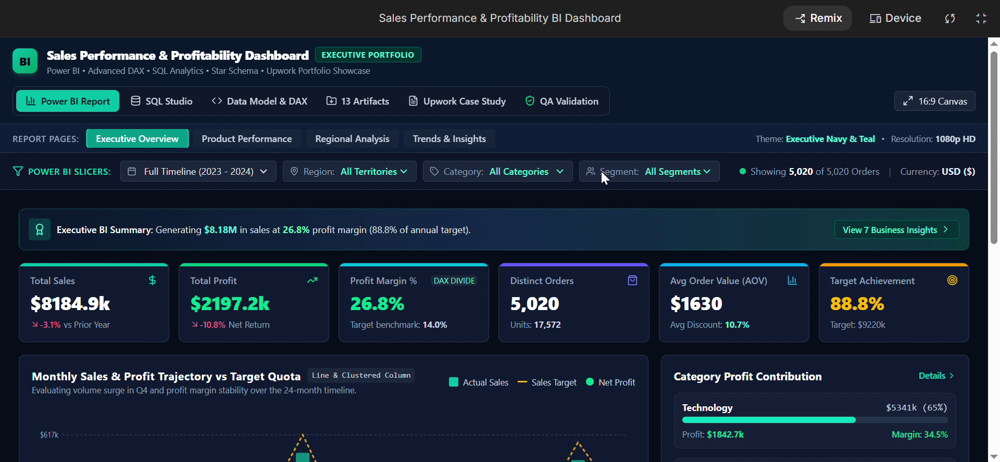
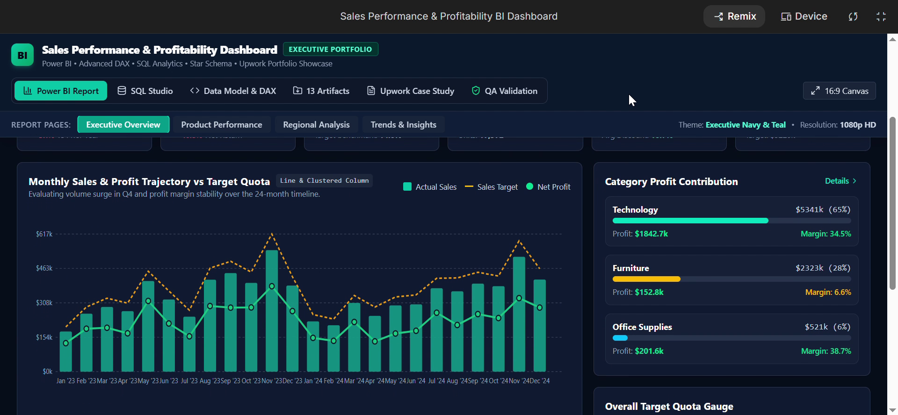
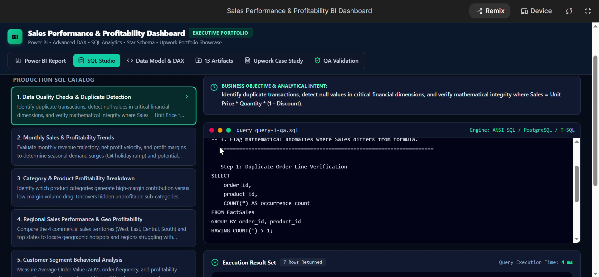

# Sales Performance & Profitability BI Dashboard

Executive sales dashboard built on 5,020 retail orders: SQL data cleaning, star schema modeling, DAX KPIs and interactive BI reporting. **Tools:** Power BI, DAX, SQL.



## Business Problem
Leadership needed a trustworthy view of sales, profit margin and target achievement across regions and product categories. The raw data needed cleaning and validation before any KPI could be trusted.

## What I Did
- Cleaned and validated raw sales data with SQL (duplicate checks, null checks, Sales = Unit Price x Quantity x (1 - Discount) verification)
- Designed a star schema: FactSales with DimDate, DimProduct, DimCustomer, DimGeography and SalesTargets
- Built DAX measures: Profit Margin %, Average Order Value, Target Achievement
- Added slicers for date, region, category and segment
- Reconciled SQL and DAX results (0.00 variance) and documented QA checks

## Key KPIs
| KPI | Value |
|---|---|
| Total Sales | $8.18M |
| Total Profit | $2.20M |
| Profit Margin | 26.8% |
| Distinct Orders | 5,020 |
| Average Order Value | $1,630 |
| Target Achievement | 88.8% |

## Key Insights
- (Insight 1 from your Business_Insights file)
- (Insight 2)
- (Insight 3)

## Screenshots




## Repository Structure
```
├── data/      raw and cleaned datasets, data dictionary
├── sql/       SQL analysis queries
├── dax/       DAX measures
├── docs/      cleaning report, insights, case study, QA checklist
├── images/    dashboard screenshots
└── demo/      dashboard demo video
```

## Tools
Power BI, DAX, SQL (PostgreSQL / T-SQL), CSV

## Contact
Zainab Bibi | [LinkedIn](https://www.linkedin.com/in/zainab-bibi-298b3740a/)
